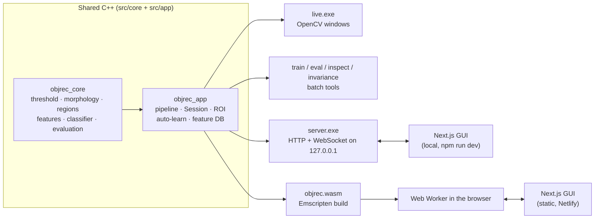
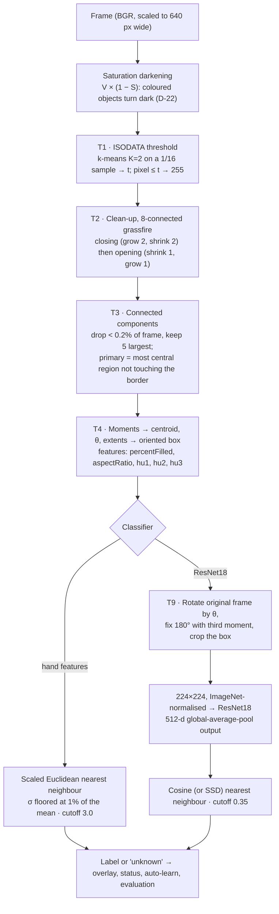
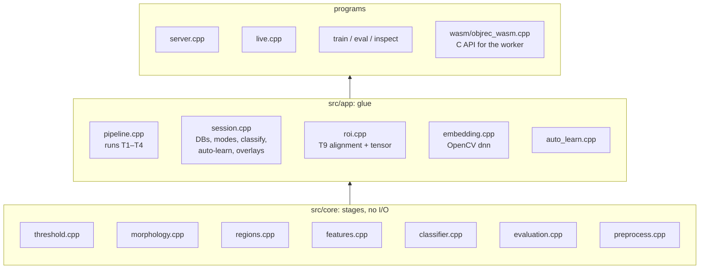
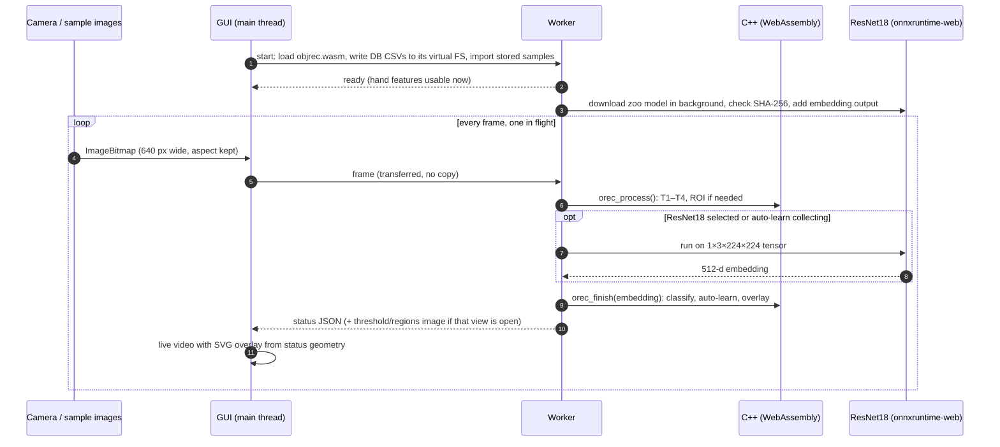
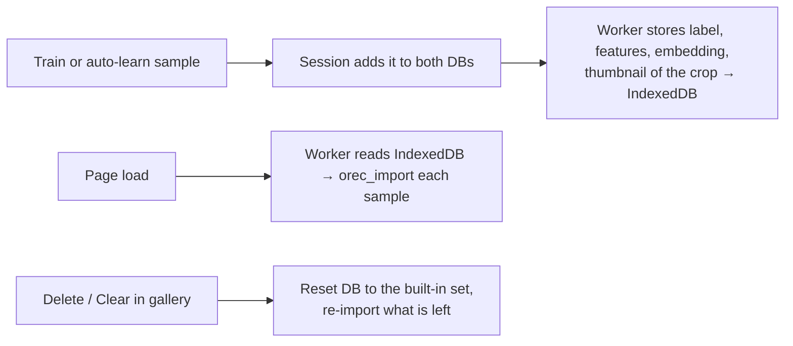
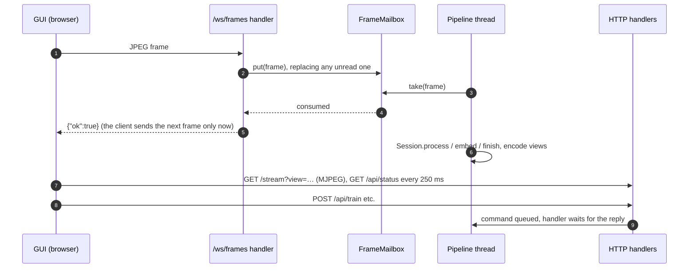
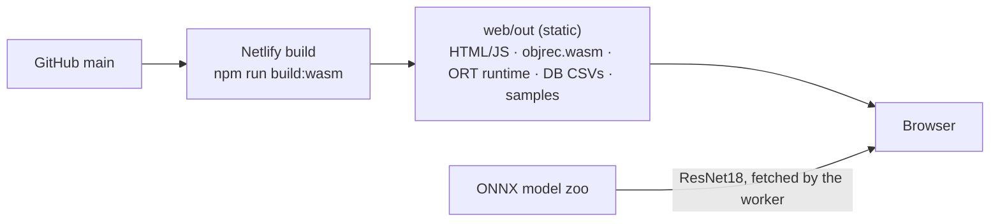

# Architecture

One C++ recognition pipeline, three ways to run it. The same source files run as native
programs on a laptop and, compiled to WebAssembly, inside a browser tab. That last route is
how the public demo works with no server at all. Decision IDs (D-xx) refer to
[docs/mentorship/decisions.md](docs/mentorship/decisions.md), where each choice is recorded with
the alternatives that were rejected.

## 1. Three runtimes, one pipeline

| Runtime | Frames come from | ResNet18 runs in | Used for |
|---|---|---|---|
| `live.exe` | camera, IP Webcam URL, video or image folder | OpenCV dnn | development, capturing training images |
| `server.exe` + GUI | the GUI's camera over a WebSocket, or a fixed source | OpenCV dnn | local GUI with saving to disk |
| browser build | the browser camera, or bundled sample images | onnxruntime-web (WebGPU, else WebAssembly) | the public demo, phones |

The browser build exists because free hosting for a C++ server is gone: Hugging Face Docker
Spaces need a paid plan and the free alternatives run on a tenth of a CPU (D-26, D-27).

## 2. What happens to one frame

Every stage is a pure `cv::Mat` in, `cv::Mat` out function with no windows or cameras. That
rule, set on day one, is what later let the whole pipeline compile to WebAssembly unchanged.

## 3. Code layers

`Session` holds everything between "a frame arrived" and "here is the status": both
databases, the label, the mode, the chosen classifier and metric, auto-learn and live
evaluation. `server.exe` and the browser build both drive the same `Session`, so the GUI
behaves the same against either (D-27). Embedding is two-phase, `process()` → embed the ROI →
`finish()`, because the browser's ResNet18 is asynchronous.

## 4. Browser build (the public demo)

- **Live view (D-29).** The annotated view shows the camera itself at full frame rate and draws the box, axis and label as SVG from the latest status. Before this, the picture refreshed only as fast as recognition ran.
- **Model (D-27).** ResNet18 comes straight from the ONNX model zoo's file host and is checked against the pinned SHA-256. onnxruntime returns only declared outputs, so the worker splices a 46-byte protobuf field into the model to declare the embedding layer as an output; the weights are untouched.
- **Speed.** Hand features ~10 fps. ResNet18 ~15 fps on WebGPU, ~3.6 fps on single-threaded WebAssembly.
- **Correctness.** The WebAssembly build gives the same thresholds, features and predictions as `server.exe` (relative difference 0), and the browser embedding matches OpenCV dnn's (cosine distance 8e-8).

### Samples that survive a refresh (D-28)

Up to 50 samples per browser, on that device only.

## 5. Local server mode

- **Flow control (H-50).** One frame in flight: a slow pipeline lowers the frame rate instead of growing a queue (which would show you the past and eventually run out of memory).
- **Threading.** Only the pipeline thread touches the `Session`. HTTP handlers queue commands and wait for the result, so no locks guard the databases.
- **Security.** Binds 127.0.0.1, rejects other websites by `Origin` (WebSockets are not covered by CORS), and Next binds to loopback too, so the LAN can't reach the API through its proxy.

## 6. Deployment

[netlify.toml](netlify.toml) sets JavaScript content types for the `.mjs` modules (module
workers reject anything else) and caching. The WebAssembly module is committed because
Netlify's build image has no Emscripten; [wasm/build.sh](wasm/build.sh) reproduces it.

## 7. Key decisions

| ID | Decision | Rejected |
|---|---|---|
| D-04 | Pure `cv::Mat` stages, one executable per job | stages with I/O inside |
| D-09 | OpenCV connected components for T3; time went to extensions | from-scratch two-pass labelling |
| D-14 | Separate test captures; leave-one-out and one-shot as extra protocols | testing on training images |
| D-16 | ResNet18 embeddings for T9 | YOLO: a closed-set detector that needs retraining with boxes |
| D-17 | Auto-learn takes one sample per pose | bursts of near-identical frames |
| D-22 | Saturation darkening before ISODATA | plain grayscale (coloured objects vanished) |
| D-24 | Browser camera over WebSocket, one frame in flight | POST per frame |
| D-27 | Pipeline in the browser (WebAssembly + onnxruntime-web) | paid hosting, a TypeScript rewrite |
| D-29 | Live video with a drawn overlay; ResNet18 on WebGPU | embedding every Nth frame |
