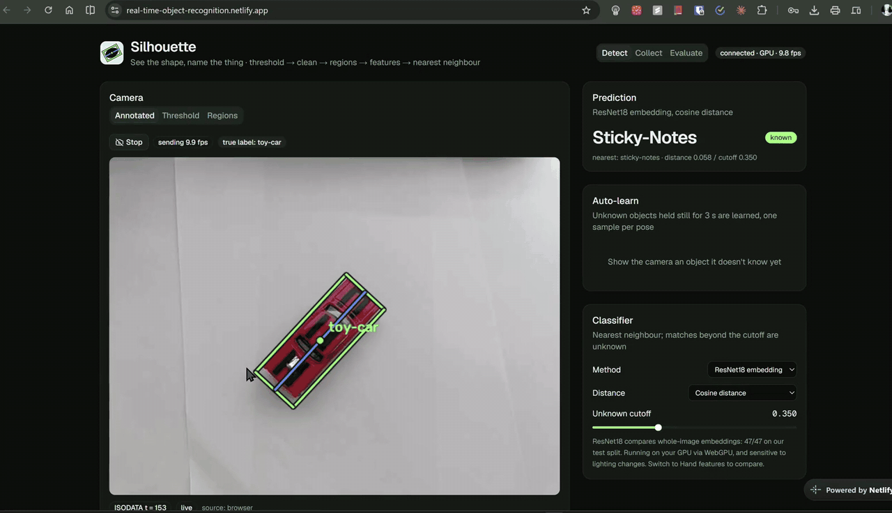
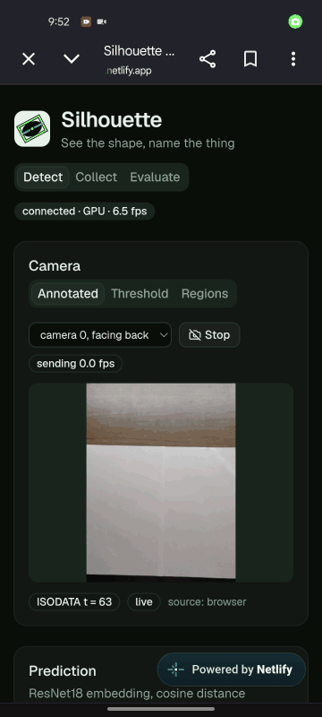
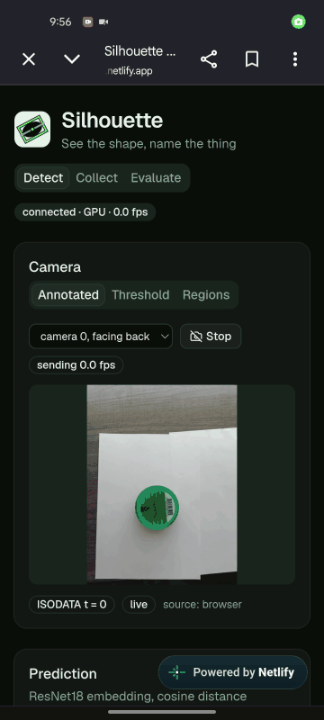
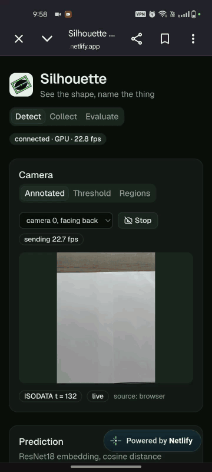
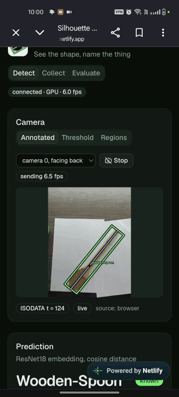
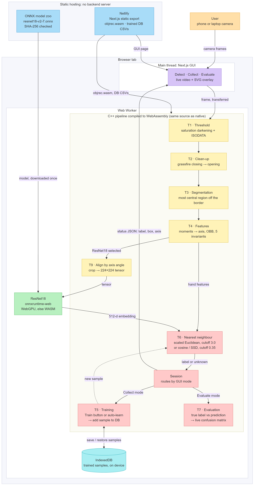

# Silhouette: real-time 2-D object recognition

Silhouette recognises objects lying on a plain, light background from a top-down camera. It
segments the object, describes its shape with translation-, scale- and rotation-invariant
features, and names it by nearest neighbour against a trained database. A second classifier
compares ResNet18 embeddings of the aligned object, so the classical and the learned approach
can be compared on the same frames.

| | |
|---|---|
| Demo videos | [below](#demo) |
| Live demo | https://real-time-2d-object-recognition.netlify.app (runs entirely in your browser; deployed from `main`) |
| Report | [report.pdf](report.pdf) |
| Time travel days used | 0 |

## Demo

### Sample images

The deployed site classifying the bundled sample images (Collect → samples source), with the
true label shown next to the prediction.

[](public/demo/samples.mp4)

Silent looping preview; click it for the full video ([samples.mp4](public/demo/samples.mp4), 28 s).

### Live camera and unknown objects

Phone camera on the deployed site, ResNet18 cosine classifier. Silent, sped-up previews; click one for the full video.

<table>
  <tr>
    <td width="50%" valign="top">
      <a href="public/demo/detect-trained-objects.mp4"></a>
      <br><b>Trained objects</b> (66 s): every trained object recognised as known.
    </td>
    <td width="50%" valign="top">
      <a href="public/demo/misclassified-similar-shapes.mp4"></a>
      <br><b>Look-alikes</b> (30 s): new objects whose silhouettes match trained ones are named as those (a round tin as batteries, a snack bag as notebook) at the default cutoff of 0.350.
    </td>
  </tr>
  <tr>
    <td width="50%" valign="top">
      <a href="public/demo/autolearn-unknown-low-cutoff.mp4"></a>
      <br><b>Auto-learn</b> (103 s): with the unknown cutoff lowered to 0.200, a spoon is flagged unknown, named, learned and then recognised.
    </td>
    <td width="50%" valign="top">
      <a href="public/demo/dataset-after-autolearn.mp4"></a>
      <br><b>Database</b> (49 s): Collect mode listing the samples, with the auto-learned object added.
    </td>
  </tr>
</table>

## What it does

- **Tasks 1–4, classical pipeline:** saturation darkening, ISODATA threshold (written from scratch), grassfire grow/shrink clean-up (written from scratch), connected components, moments, primary axis, oriented bounding box, five invariant features.
- **Tasks 5–7:** training from the live window, the web GUI or a batch tool; scaled-Euclidean nearest neighbour with unknown-object detection; evaluation with confusion matrices.
- **Task 9:** one-shot classification with ResNet18 embeddings (cosine or SSD) on an aligned crop of the object.
- **Extensions:** auto-learn of unknown objects, a web GUI with Detect / Collect / Evaluate modes, 10 objects, measured feature invariance, and a serverless browser build: the same C++ compiled to WebAssembly, ResNet18 on WebGPU, usable on a phone.

Results on 47 held-out test images: hand features 26/47 (55%), ResNet18 cosine 47/47 (100%), ResNet18 SSD 45/47 (96%). Details in the report (figures in [docs/report/figures](docs/report/figures/)) and [ARCHITECTURE.md](ARCHITECTURE.md).

## Architecture



The public demo has no backend server. The same C++ pipeline that builds natively is compiled to WebAssembly and runs in a Web Worker; ResNet18 runs on the GPU through WebGPU, and trained samples stay on the device. More diagrams, including the native and local-server modes, are in [ARCHITECTURE.md](ARCHITECTURE.md); the source of this one is [architecture.mmd](docs/report/figures/architecture.mmd).

## Repository layout

```text
include/ src/core/   pipeline stages: threshold, morphology, regions, features, classifier, evaluation
include/ src/app/    glue shared by every program: pipeline, Session, ROI + embedding, auto-learn, DB
src/apps/            one executable per job: live, server, train, eval, inspect, invariance
tests/               unit tests (morphology, auto-learn, embedding, mailbox, classifier)
wasm/                Emscripten build of the same C++ for the browser
web/                 Next.js GUI (local server mode and the serverless browser build)
data/objects/        58 training captures, one folder per label
data/test/           48 held-out test captures
data/db/             trained databases (features, ResNet18 embeddings)
docs/mentorship/     decision log (D-00 to D-29), hint log, scoreboard
docs/report/         report figures
docs/wiki/           revision notes for the Q&A
transcripts/         the AI-assisted development sessions, conversation only
third_party/         cpp-httplib (vendored), instructor utilities (reference, unmodified)
```

## Build and run (native, Windows)

Requirements: Visual Studio 2026 with C++, CMake 3.20+, OpenCV 5.0 at `C:/opencv/build`.

```powershell
cmake --preset msvc
cmake --build --preset release       # executables land in out/
```

ResNet18 is not committed (47 MB). Fetch it once; the SHA-256 is in [data/models/README.md](data/models/README.md):

```sh
curl -L -o data/models/resnet18-v2-7.onnx https://github.com/onnx/models/raw/main/validated/vision/classification/resnet/model/resnet18-v2-7.onnx
```

| Program | What it does |
|---|---|
| `out/live.exe [camera \| video \| url \| dir]` | OpenCV windows. Keys: `n` type a label, `t` train, `s` save the frame and stages, `q` quit |
| `out/server.exe [--browser \| source] [port]` | Backend for the web GUI on 127.0.0.1:8080; `--browser` takes frames from the GUI's camera |
| `out/train.exe [--embed]` | Rebuild `data/db/` from `data/objects/<label>/` |
| `out/eval.exe data/test --train data/objects [--one-shot]` | Confusion matrices for hand features and ResNet18 → `out/eval/` |
| `out/inspect.exe <dir>` | Every stage as images, feature vectors, labelled results → `out/stages/` |
| `out/invariance.exe <dir>` | Feature drift under rotation and scale → `out/invariance/` |
| `out/tests.exe` etc. | Unit tests |

## Web GUI

```sh
cd web && npm ci
npm run dev          # GUI for server.exe: start out/server.exe first, open http://localhost:3000
npm run dev:wasm     # serverless build: the pipeline runs in the browser, no server.exe needed
npm run build:wasm   # static site in web/out/ (what Netlify publishes)
```

The WebAssembly module in `web/public/wasm/` is committed. Rebuild it with Docker after changing the C++ (see [wasm/build.sh](wasm/build.sh)):

```sh
docker run --rm -v objrec-wasm:/w -v "$PWD:/repo" emscripten/emsdk:3.1.74 bash /repo/wasm/build.sh
```

## Documentation

- [ARCHITECTURE.md](ARCHITECTURE.md): how the pieces fit, with diagrams.
- [docs/mentorship/decisions.md](docs/mentorship/decisions.md): every design decision with its options and trade-offs.
- [docs/wiki/](docs/wiki/Home.md): revision notes on the concepts behind each part.
- [transcripts/](transcripts/): the development conversations with the AI assistant.

## Acknowledgements

- Bruce A. Maxwell's course utilities: Task 9 alignment and embedding approach, adapted to OpenCV 5 ([third_party/maxwell](third_party/maxwell/), unmodified).
- ResNet18 v2 from the [ONNX model zoo](https://github.com/onnx/models); OpenCV 5; [cpp-httplib](https://github.com/yhirose/cpp-httplib); onnxruntime-web; Emscripten; Next.js and shadcn/ui.
- Built with Claude (Anthropic) as mentor and pair programmer; see the report's acknowledgement and [transcripts/](transcripts/) for what was written by hand and what was AI-assisted.
